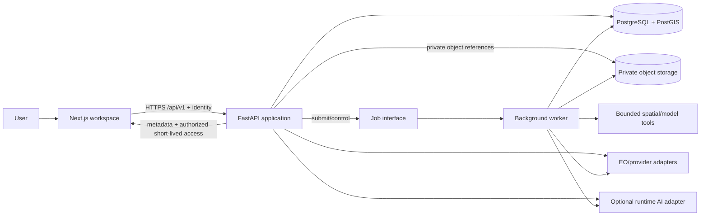
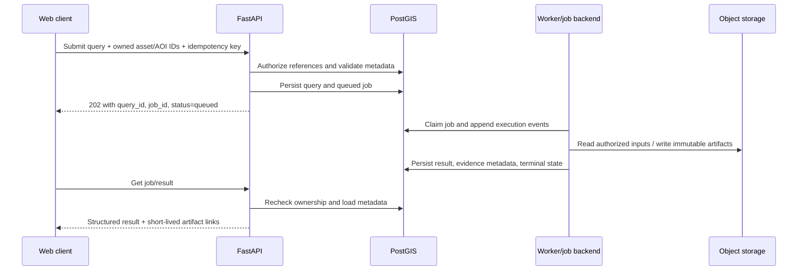

# Architecture

## Phase 10A+B GeoAgent planning boundary

The typed conversation request/response seam is in `satquery.api.schemas.geoagent`; pure deterministic meaning-to-intent routing is in `satquery.agent.routing`. It accepts only validated, stable selected-scene/AOI context and emits a non-executing plan, clarification, unsupported outcome, or explicit dependency unavailability. The router never accepts an asset URL/path, dispatches a tool, creates a conversation row, claims a model answer, or substitutes a basemap/thumbnail for scientific data. Execution is a separate authorized 10C boundary below; `plan_ready` is not scientific readiness. Phase 7 model availability, Phase 8 protected-job completion, and Phase 9 joint real-data/registration gates remain independent and partially verified.

## Phase 10C protected tool execution

`satquery.agent.execution` adds a small closed registry and dispatch layer behind `/api/v1/geoagent/execute`. FastAPI resolves the verified processing principal before routing; the executor constructs validated existing service requests from the selected stable IDs/AOI and calls trusted tile metadata, inference, change, or optical/SAR methods. Job services retain owner/access-scope authorization, source re-resolution, idempotency, worker limits, cancellation, atomic artifacts and quality gates. The GeoAgent imposes bounded submission timeouts and records only safe intent/tool/source/job/result identifiers plus actual status/output; it neither waits for long inference nor fabricates a completion percentage or measurement. Optical change date ordering is checked against catalogue metadata again before submission. Imagery tile metadata is display-only. MapLibre/Terra Draw navigation remains browser-local, so map-action execution is explicitly unavailable until a later authorized UI bridge. This 10C route introduces no alternate worker stack.

Task 10D adds a separate `agent.conversation` resolver and `db.geoagent_conversations` persistence boundary. The verified principal and conversation UUID partition validated AOI/dated-scene context; a required expected selection revision plus compare-and-swap version guard stale requests/concurrent updates and prevent a late tool result from joining changed inputs. Only owner-checked committed artifacts become verified analysis references; queued jobs remain status references and may be refreshed through existing protected job services after restart. Raw prompt/output text is not retained in conversation state. The protected turn/read/delete routes fail closed without PostgreSQL and identity. Browser map mutation remains unavailable until 10E; this is not the broader owned session/history system.

## Phase 8E change integration

Two-date analysis is a separate bounded processing operation, not a browser calculation or Phase 7 inference task. The backend reuses trusted provider resolution, preparation, registration, validity, durable jobs, atomic storage and scoped cache identity before invoking the deterministic detector and summary. The browser receives only a committed result and owner-authorized categorical tiles; MapLibre opacity is display-only and never changes scientific values.

## Current implementation

Phase 1 implements the two-process development foundation, and independently authorized Phase 2 extends only the web presentation boundary:

- a Next.js App Router public homepage and unified responsive workspace shell with local layout/draft state, explicit empty/unavailable states, and no authoritative computation;
- focused homepage, navigation, scene, assistant, tabs, and dialog components with a centralized feature-availability registry;
- a typed frontend health client that validates all JSON at runtime and distinguishes configuration, cancellation, timeout, network, dependency, and contract failures;
- a FastAPI application factory with lifespan cleanup, validated root settings, exact-origin CORS, request IDs, JSON logs, consistent safe errors, OpenAPI, and separate liveness/readiness routes;
- async SQLAlchemy/Psycopg engine and session ownership with bounded real readiness queries;
- PostgreSQL/PostGIS development and isolated-test Compose services plus an explicit Alembic baseline enabling PostGIS; and
- npm/pip lockfiles, backend/frontend tests, and PowerShell setup/verification workflows.

Phase 3 extends `SceneContainer` with a dynamically loaded MapLibre/OpenFreeMap basemap and Terra Draw editor. `WorkspaceShell` owns typed `SelectedAoi` state through `useAoiDraft`; committed geometry is separate from provisional drawing/edit previews. `aoi.ts` validates input and recomputes winding, bounds, and approximate Turf area. These browser measurements describe selected geometry, not analytical findings. Versioned local storage is read after mount and validated before restoration. ResizeObserver and effect cleanup manage map sizing and lifecycle.

Phase 4 task 4A adds the provider-neutral backend catalogue schema boundary. Task 4B adds a typed internal provider protocol and one metadata-only Earth Search STAC adapter for the allow-listed `sentinel-2-c1-l2a` collection. Task 4C exposes that adapter through lifespan-managed FastAPI collection, search, and item-detail routes. Task 4D adds an embedded workspace discovery panel and Zod response/error validation at the browser boundary. It derives exact searches from the selected AOI, cancels or disregards obsolete work, keeps result pages associated with their source fingerprint, and forwards the API continuation cursor rather than emulating offsets. Task 4E maps normalized scene footprints through a dedicated MapLibre GeoJSON source/layers and keeps composite provider/collection/item metadata selection in `WorkspaceShell`, independently of the AOI. Card/map hover and selection synchronize; AOI changes make prior context stale and revalidate selection; style reloads restore layers and unmount removes listeners. Task 4F adds a closed, versioned browser selection draft containing stable identity, cursor-free query, and safe provenance; restore revalidates the draft and re-fetches current metadata through the existing item-detail route. Temporary preview URLs, expiries, credentials, and provider cursors are never durable. The routes remain independent of database access/persistence; outbound requests remain restricted to the exact configured Earth Search HTTPS v1 origin/path, redirects are disabled, and no raster bytes are fetched. No authenticated saved-search resource or owned analytical asset-selection state exists. The Phase 4 tracker is `docs/PHASE_4_IMPLEMENTATION_TRACKER.md`.

Phase 5 task 5A adds a contract layer only: closed Pydantic schemas in `backend/src/satquery/api/schemas/viewer.py` and matching browser Zod/type schemas in `frontend/src/lib/viewer-contracts.ts`. Stable scene identity remains provider + collection + item. Resolved asset identity adds an asset identifier/version but no URL. Tile delivery metadata is separate, expiring, and restricted to a relative FastAPI-mediated template. Active layer state keeps display settings and rendering outcome separate from catalogue availability, asset access, and analysis readiness. Comparison/timeline state carries exact identities and acquisition intervals, while versioned saved state excludes transient delivery/access/render data. See `docs/PHASE_5_TASKS.md`.

Phase 5 task 5G implements that saved state only as a validated browser-local draft bound to the Phase 4 AOI geometry fingerprint. Camera, stable active asset/preset/display, comparison slots, and active timeline identity may persist; provider/tile URLs, tile-set IDs, access/expiry state, credentials, pixels, and render claims may not. Restoration reuses refreshed catalogue metadata and re-resolves tile access through FastAPI.

Task 5B extends the existing provider-neutral catalogue protocol and FastAPI router with a stateless asset-resolution operation. The Earth Search implementation re-fetches a selected `sentinel-2-c1-l2a` item by stable provider/collection/item identity, derives RGB components from STAC role and band metadata rather than asset-key conventions, preserves per-band raster/projection metadata, and returns a single allow-listed natural-colour visualization preset. Source locations stay inside the adapter. Exact HTTPS host/collection-path validation applies to the initial location and every bounded redirect, and accessibility is established with HEAD only. A failed metadata/access check returns no usable resolved asset. Thumbnails remain separate. The route does not persist state, deliver tiles, expose raster bytes/URLs, render imagery, or assess analysis readiness.

Task 5C adds a lifespan-managed `ImageryTileService` behind closed `/imagery/tile-sets` and opaque-ID PNG tile routes. It always reuses 5B resolution, retains source locations server-side, revalidates the exact Earth Search object destination, and exposes only `natural-color`, 256-pixel WebMercatorQuad tiles through the relative 5A template. rio-tiler/Rasterio performs windowed COG/overview reads, reprojection, masking, and PNG encoding in bounded worker threads. An internal HTTP range opener avoids full-scene downloads and enforces response ranges, byte/request/time/cache limits. Tile-set and byte caches are bounded and access-scoped.

Task 5D adds a browser-only display adapter around the existing MapLibre instance. It runtime-validates 5C metadata, adds one `xyz` raster source/layer below AOI and catalogue footprints, keeps attribution and lifecycle state explicit, and removes listeners/source/layer on scene replacement, style reload, or unmount. A request sequence and abort signal prevent stale metadata from replacing a new selection. The layer is visualization only and creates no analytical intake or persistence.

Task 5E keeps display adjustment inside that adapter: a validated settings object updates the existing raster layer's layout/paint properties after a bounded debounce, preserving the source and map camera. The renderer remains fixed to natural-colour red/green/blue with per-band scale/offset and a scene-stable 0.00–0.30 reflectance range; unsupported presets are disabled rather than synthesized client-side. These controls are presentation state, not source-data transformation or analysis.

Task 5F adds a comparison adapter owned by the existing workspace. It creates two bounded MapLibre maps only after distinct chronological scene assignment and bbox-overlap validation, resolves each independently through 5C, synchronizes center/zoom/bearing/pitch behind a re-entry guard, and supports swipe/split layouts with native keyboard input. Each side retains independent lifecycle and visible settings; cleanup aborts requests, detaches listeners, and removes both maps. The evaluated comparison plugin was not added because its imperative DOM ownership and older documented MapLibre target did not remove these SatQuery-specific responsibilities.

Phase 6 task 6A adds only the server-side contract seam for future optical preparation in `backend/src/satquery/api/schemas/processing.py`. It reuses the existing stable scene identity and validated AOI types, restricts the initial profile to the working Earth Search Sentinel-2 L2A collection, and models a bounded request, deterministic output grid, prepared raster, separate validity/quality masks, source calibration, processing provenance, measured quality checks, task readiness, job lifecycle, and opaque artifact references. The result model deliberately permits technically successful processing with non-ready or unresolved suitability. No route imports this schema, no browser bypass exists, and no worker, object storage, database row, source fetch, prepared byte, pair alignment, AI output, or change result is created in 6A.

Phase 7 task 7A adds only the server-side contract seam in `backend/src/satquery/api/schemas/vqa.py`. A future adapter may receive a bounded server-created RGB chip only from an authorized Phase 6 prepared raster. The chip records a fixed rendering and exact pixel-edge-to-map transform while retaining its Phase 6 quality context. Model prose, evidence references, and optional grounding remain separate from calibrated raster measurements. The selected hosted model is not called in 7A; no route, job, persistence, browser model access, or provider credential handling is introduced.

Phase 8 task 8A adds the independent server-side two-date result seam in `backend/src/satquery/api/schemas/change.py`. It reuses stable scene identity, validated AOI, `OutputGrid`, artifact, digest, and software-version types. Cross-field validation binds chronological sources to both prepared-scene provenance records and the Phase 6 preparation job/parameter digest, while enforcing exact changed/unchanged/unknown count, fraction, and projected-cell-area arithmetic. The seam recognizes an opaque `change_classification` GeoTIFF kind but introduces no job operation, route, migration, detector, raster writer, database record, or workspace behavior.

Task 8B inserts one internal comparability assessment into the existing `prepare_optical` pair worker after common-grid registration and Phase 6 validity. It uses the effective corrected moving scene only when Phase 6 independently accepted that translation, rebuilds joint masks from both dates, and writes them through the existing atomic artifact store. The manifest records an allow/reject decision and reproducibility evidence; rejection never emits a classification. The existing protected route, repository, owner/scope checks, and operation remain unchanged. No separate change worker/API/UI is introduced.

Task 8C adds a pure internal `OpticalChangeDetector` downstream of an exact 8B `comparable` outcome. It revalidates the source/grid/registration binding, both-date masks, and dimensionless calibrated RGB metadata, then computes versioned RGB RMS surface-reflectance difference only on joint-usable pixels. A fixed provisional 0.05 threshold maps those pixels to changed/unchanged while every excluded cell stays unknown. No independent normalization, radiometric harmonization, display input, semantic cause, artifact, job, route, or UI is introduced; those integration boundaries remain 8D or later.

The user-authorized 8D scope adds an internal measurement/summary layer, superseding the provisional 8D integration placeholder. A shared area primitive derives cell area from the affine determinant and projected-CRS unit conversion, rejecting geographic degrees. The summary binds the exact request/pair/grid/registration/detector result; divides changed extent by joint-valid observed support; reports AOI coverage, usability, and unknown area independently; and renders only deterministic computed statements. No protected change job, result artifact, API route, database record, or UI is added.

Task 7B implements the internal adapter seam in `satquery.inference`. A chip processor consumes only trusted calibrated extraction plus decoded quality masks (or later an authorized prepared artifact), produces a checksum-bound fixed-render PNG, and preserves scientific provenance/geometry separately. A one-slot-by-default service calls only the pinned hosted Responses endpoint when all server settings exist. Quality and unsupported-question guards run before inference; provider output is schema-validated and remains non-measured prose. The app lifespan owns the optional client, but no public route, durable inference job, browser call, or artifact publication exists in 7B.

Task 7C adds a separate lazy local Grounding DINO service. It consumes the exact same validated chip bytes, never a thumbnail or basemap, and rechecks checksum and Phase 6 readiness. A selected visual-prompt region is cropped before the checkpoint processor and retained separately from predictions. Processor postprocessing maps resize/padding output back to the crop; SatQuery clips it, applies the crop offset, and transforms box corners with the chip affine. Only rectangular boxes are supported. The service runs CPU work off the event loop with bounded concurrency/time and has no route, job, persistent model artifact, or workspace integration.

Tasks 7D–7E connect both inference services through operation-scoped durable job rows, atomic private exact-chip/evidence artifacts, owner/scope-authorized routes, and the workspace assistant. Stable scene/AOI references are resolved server-side; quality blocks or warns before inference. The UI binds text and validated geometry to the exact source chip, suppresses overlays for stale selections, and never treats provenance or detector scores as proof. Task 7F verified one real QA-ready chip through local grounding, while hosted VQA/caption and production database/identity remain unavailable.

Task 6D adds an in-memory harmonization stage after the trusted 6B raster and 6C quality stages. It derives one supported UTM grid from the AOI, snaps a single origin/extent to the requested resolution, and reprojects every input to that identical grid. Continuous values use the recorded method with nodata-aware interpolation; validity and categorical masks use nearest-neighbour. The stage preserves calibrated source values/metadata, computes individual and joint coverage on projected pixels, and does not claim registration, radiometric harmonization, persistence, or readiness.

Task 6E adds a bounded in-memory registration stage for the 6D pair. It uses a comparable calibrated band and the intersection of per-band validity with decoded quality usability, evaluates a 3×3 distributed patch layout with masked normalized correlation, derives translation only from alternating estimation patches, and reserves the other patches for independent before/after residual validation. Only an agreed integer translation may copy scene B data and masks; originals remain attached and overlap is recomputed. Matching grids, single scores, missing diagnostics, and unvalidated shifts remain inconclusive. No flexible warp, persistence, route, or ground-truth accuracy claim is introduced.

Task 6F adds an in-memory deterministic validity engine over 6B–6E evidence. Versioned task profiles and explicitly provisional thresholds produce individual evidence-bearing checks and a task-scoped readiness state; missing required evidence cannot become ready, and this decision does not affect catalogue or map access.

Task 6G connects these stages through a lifespan-managed, bounded in-process dispatcher backed by PostgreSQL job/artifact/event metadata. Raster and CPU work remains outside the request event loop. The dispatcher records real stage units, reconciles interrupted running/cancelling attempts to failed after restart, resumes durable queued work, and supports cooperative cancellation at stage boundaries. A server-controlled private filesystem backend is the smallest current artifact implementation: writes use temporary files plus atomic rename, while one database transaction publishes artifact rows and success. Missing files, incomplete rows, and non-succeeded jobs are not served or reused. This local backend is replaceable by the confirmed private-object-storage boundary; it is not a public storage decision.

Protected processing routes require an injected verified `ProcessingPrincipal`; there is deliberately no client-supplied owner header or development authorization bypass. Until the unresolved identity integration is configured, only these protected routes return capability-unavailable. Public catalogue and imagery routes remain independent. Task 6I exercised this separation with a successful real catalogue query alongside explicit processing/readiness `503` responses; it did not substitute catalogue availability for scientific preparation.

Task 6B adds `RasterInputService` as an internal spatial-preparation boundary. It asks the configured provider adapter to resolve a stable public Sentinel-2 scene, reuses exact destination/header validation and bounded HTTP range reads, transforms the validated WGS 84 AOI into the source CRS, computes one native-grid window, preserves polygon holes, and reads only that window from each requested RGB asset. It emits calibrated float data, a separate inside-AOI mask, per-band validity, exact source identity/order, units, native resolution, calibration metadata, and output georeferencing. Invalid or outside-AOI cells remain invalid (`NaN`) rather than being calibrated, clamped, contrast-stretched, or normalized. There is no direct public raster-input route or authorization substitute; only the later protected 6G job may orchestrate this service after verified identity and durable acceptance.

Task 6C adds a separate `QualityMaskService`. The provider adapter resolves only the collection-defined `scl` COG by stable scene identity and returns its processing baseline plus scene-wide catalogue cloud metadata without exposing its location. The service performs bounded window reads, verifies that GDAL valid masks and NumPy invalid masks are inverse, and maps the 20 m SCL onto the 6B grid with nearest-neighbour only. Categorical labels and each exclusion reason remain separate; the combined exclusion is a boolean union so overlap is counted once. Missing QA produces explicit unknown quality and zero usable pixels. No spectral darkness heuristic is present.

The optional geocoder is a replaceable, explicit-submit Nominatim-compatible browser adapter with timeout, bounded results, and per-tab cache/throttling. It has no public Nominatim default or server credentials. Basemap/geocoder outages are separate from backend/database status. Implemented domain persistence covers the narrow 6G preparation and 7D inference job/artifact/event subsets; protected saved-catalogue resources, server-owned AOIs, a configured identity provider, uploads, general analysis workers, external object storage, and published model assets remain absent. The hosted answer adapter is unconfigured and has no verified live output. The local grounding checkpoint has one real-chip execution, but its broad box is not accuracy evidence. Real PostGIS migration/readiness and production inference persistence remain unverified. An AOI, catalogue result, resolved visualization asset, delivered/rendered tile, or healthy infrastructure never authorizes or proves an analysis result.

## Target architecture

The target is one web product with separately deployable responsibility boundaries.

| Component | Responsibility | Must not own |
|---|---|---|
| Next.js web client | Unified workspace, map/image rendering, input collection, job/result/evidence presentation | Server secrets, authoritative authorization, provider access, scientific measurement |
| FastAPI application | Authentication integration, ownership authorization, request validation, resource APIs, orchestration, signed artifact mediation | Long CPU/GPU work in request handlers, browser presentation |
| Capability/orchestration layer | Map validated query intent to allow-listed tools, verify prerequisites, create jobs, assemble result contract | Granting permissions based on model/tool text |
| Background workers | Claim jobs, obtain authorized inputs, run bounded geospatial/model tools, persist events and outputs | Public API or independent ownership policy |
| Spatial analysis tools | Deterministic/validated raster-vector preparation and analysis with explicit inputs/parameters | Persistence, user/session authorization, narrative fabrication |
| Provider adapters | EO catalogue/access and optional runtime AI calls through typed interfaces | UI state or cross-provider silent fallbacks |
| PostgreSQL/PostGIS | Ownership, resource metadata, AOIs, lineage, job state, structured results, event records | Large raster/artifact payloads |
| Private object storage | Source rasters, uploads, derived overlays/masks, and reports | Authorization decisions or sole-copy metadata |

MapLibre GL JS is the primary future map. deck.gl is added only where visualization requirements justify it. A basemap supplies visual context; it is never the analytical input unless it corresponds to a separately identified, licensed analytical asset.

## Request and analysis flow

Before job creation, the API may return validation, authorization, unsupported-capability, or unavailable-dependency errors. Query interpretation can propose a typed operation, but the server independently verifies every input and tool argument. A worker records an inspectable execution summary—not hidden chain-of-thought—and results are accepted only when their evidence and provenance satisfy the contract.

## Trust boundaries

1. **Browser to API:** browser state, geometry, filenames, query text, identifiers, and claimed metadata are untrusted. Authentication is verified and ownership is checked at each protected-resource use, not merely at UI navigation.
2. **Uploads/remote sources to processing:** file contents, archive structure, raster metadata, provider responses, redirect targets, and retrieved text are untrusted. Validation is bounded and retrieved content is data, never authority or instructions.
3. **API/worker to external services:** credentials stay server-side; outbound destinations, methods, sizes, timeouts, and redirects are policy-controlled. Provider output is schema-validated and carries provenance.
4. **Orchestrator to tools:** only allow-listed capabilities and typed parameters cross this boundary. Tools receive least-privilege asset references and resource/time limits. Model output cannot grant tools or ownership.
5. **Application to storage/database:** service identities are least privilege. Object storage remains private; signed links are short lived, owner-authorized, and excluded from persistent result bodies/logs.

Security details are authoritative in `SECURITY.md`.

## Persistence and lineage

PostgreSQL/PostGIS is the system of record for users/owners, sessions, AOIs, assets and metadata, queries, jobs/attempts, results/findings/measurements, evidence/artifact metadata, and execution events. The logical schema is authoritative in `DATABASE.md`.

Large bytes are outside relational rows. Each object reference includes an immutable storage key, checksum, media type, byte size, owner relationship, lifecycle status, and provenance. Evidence records tie coordinate geometry to the source asset and declare `pixel` or `geographic` coordinate space and CRS where applicable. Signed URLs are delivery mechanisms, never durable identifiers.

Deletion is an authorized lifecycle operation: relational records are marked/deleted according to policy, dependent jobs are stopped where possible, object deletion is queued/audited, and shared/provider assets are not removed merely because one user's reference is deleted. Exact retention and legal-hold policy is unresolved.

## Reliability boundaries

- Job state is durable and follows `API_CONTRACT.md`; workers may retry classified transient failures but cannot report guessed progress or success without committed outputs.
- Tool/model versions, relevant parameters, input checksums, transforms, and masks support reproducibility.
- Unknown measurements are null/unavailable. Partial results and expired artifacts remain visible as such.
- A generic language model may help interpret or explain, but measured geospatial claims originate in validated spatial tools and identified analytical assets.

## Phase 9A modality metadata boundary

The shared optical/SAR scene schema is an internal contract layer between future trusted provider adapters and later modality-specific preparation. It reuses stable scene identity and the established bounded WGS84 geometry types, but does not widen the Earth Search allow-list or add network, persistence, job, raster, map, or UI behavior.

Optical bands and SAR polarizations are different discriminated payloads. Calibration and valid-data masks are evidence-bearing subcontracts rather than boolean readiness flags. Unavailable provider metadata and unsupported two-scene combinations remain typed outcomes, so a later adapter cannot silently fill missing scientific fields or reinterpret optical preparation as SAR support. Any future 9B adapter remains server-side and must populate this contract from trusted provider metadata without exposing asset URLs or paths.

## Phase 9B Sentinel-1 RTC boundary

`InpeSarProvider` is a separate trusted adapter for public INPE collection `sentinel-1-rtc-1`; it does not widen the Earth Search optical adapter. It validates the STAC origin, fixed collection, stable item identity, actual advertised polarizations, and each RTC GeoTIFF destination. `SarRasterService` performs bounded worker-thread window reads, AOI masking, and exact-grid layover/shadow-mask application. Provider-supplied GRD-derived Level-2 RTC gamma-0 power is already calibrated and terrain-normalized, so SatQuery applies identity calibration once and preserves linear values.

Display conversion is isolated: a cached PNG uses fixed -25 to 0 dB scaling and scientific-mask transparency. It is never fed into analysis. Phase 9B uses a bounded in-memory preparation cache and adds no durable job, artifact, WebMercator layer, UI, pair/fusion path, classifier, or semantic interpretation.

## Phase 9C NISAR GCOV boundary

The `NisarCmrProvider` queries public NASA CMR with bounded AOI/time filters and re-resolves a stable ASF granule concept ID before ingestion. It accepts only the PROVISIONAL L2 GCOV L-SAR collection and an allow-listed ASF HDF5 host; no client asset location is trusted. Authentication and full HDF5 staging occur on the backend host outside the application. `NisarGcovIngestionService` uses pinned `h5py` to validate the product's projection/EPSG, metre coordinate axes, source units, diagonal covariance layer, and aligned categorical mask before a native-grid window capped at one million pixels. GCOV mask values 1–254, non-fill finite values, and the AOI determine usable linear gamma-0 power. Product CRID/maturity, QA availability, native geometry, and limitations remain attached to the result. Stage files and analytical arrays are not a durable protected job/artifact or scientific classifier; live PROVISIONAL pixel access remains unverified pending Earthdata Login staging.

## Existing-to-target migration question

## Phase 9D optical/SAR co-location boundary

`OpticalSarPairService` composes existing trusted Sentinel-2 raster/SCL extraction and INPE Sentinel-1 RTC preparation. Native reflectance and C-band linear gamma-0 remain separate analytical channels; no cross-sensor radiometric harmonization, cause classifier, or SAR/NISAR fusion is introduced. The optical AOI-defined UTM grid is authoritative. Continuous SAR power is reprojected with bilinear interpolation over valid source cells; validity and provider terrain categories use nearest-neighbour sampling. Both source masks and the AOI form the joint usable mask. The result records the actual UTC gap, native/output resolution, projected cell area and AOI-denominator coverage.

Independent corresponding feature controls are required to verify cross-modal alignment; matching grid metadata and coverage alone return `insufficient_evidence`. There is no geometric correction. The real path accepts only stable scene identities and a validated AOI through existing trusted providers. The service is internal and does not create a protected job, artifact, map, or workspace feature; those remain the explicit 9E boundary. Live NISAR PROVISIONAL ingestion and 9C access remain separate blockers.

## Existing-to-target migration question

No pre-Phase-1 implementation was found, so no legacy migration was required. Phase 2 should extend the current frontend boundary without moving protected access or authoritative computation into the browser. If an external prototype or Antigravity design is later supplied, compare it with both this current implementation and the target boundaries, then record a migration decision without silently replacing either source.
