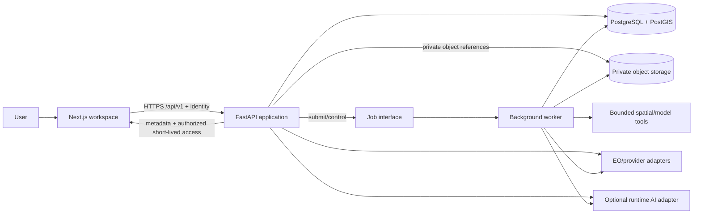
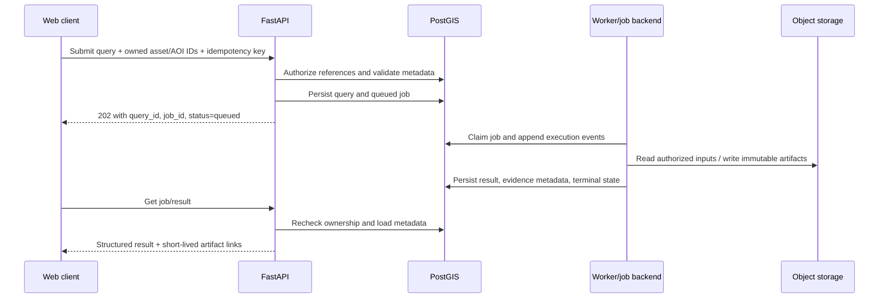

# Architecture

## Current implementation

Phase 1 implements the two-process development foundation, and independently authorized Phase 2 extends only the web presentation boundary:

- a Next.js App Router public homepage and unified responsive workspace shell with local layout/draft state, explicit empty/unavailable states, and no authoritative computation;
- focused homepage, navigation, scene, assistant, tabs, and dialog components with a centralized feature-availability registry;
- a typed frontend health client that validates all JSON at runtime and distinguishes configuration, cancellation, timeout, network, dependency, and contract failures;
- a FastAPI application factory with lifespan cleanup, validated root settings, exact-origin CORS, request IDs, JSON logs, consistent safe errors, OpenAPI, and separate liveness/readiness routes;
- async SQLAlchemy/Psycopg engine and session ownership with bounded real readiness queries;
- PostgreSQL/PostGIS development and isolated-test Compose services plus an explicit Alembic baseline enabling PostGIS; and
- npm/pip lockfiles, backend/frontend tests, and PowerShell setup/verification workflows.

Phase 3 extends `SceneContainer` with a dynamically loaded MapLibre/OpenFreeMap basemap and Terra Draw editor. `WorkspaceShell` owns typed `SelectedAoi` state through `useAoiDraft`; committed geometry is separate from provisional drawing/edit previews. `aoi.ts` validates input and recomputes winding, bounds, and approximate Turf area. These browser measurements describe selected geometry, not analytical findings. Versioned local storage is read after mount and validated before restoration. ResizeObserver and effect cleanup manage map sizing and lifecycle.

Phase 4 task 4A adds the provider-neutral backend catalogue schema boundary. Task 4B adds a typed internal provider protocol and one metadata-only Earth Search STAC adapter for the allow-listed `sentinel-2-c1-l2a` collection. Task 4C exposes that adapter through lifespan-managed FastAPI collection, search, and item-detail routes. Task 4D adds an embedded workspace discovery panel and Zod response/error validation at the browser boundary. It derives exact searches from the selected AOI, cancels or disregards obsolete work, keeps result pages associated with their source fingerprint, and forwards the API continuation cursor rather than emulating offsets. Task 4E maps normalized scene footprints through a dedicated MapLibre GeoJSON source/layers and keeps composite provider/collection/item metadata selection in `WorkspaceShell`, independently of the AOI. Card/map hover and selection synchronize; AOI changes make prior context stale and revalidate selection; style reloads restore layers and unmount removes listeners. Task 4F adds a closed, versioned browser selection draft containing stable identity, cursor-free query, and safe provenance; restore revalidates the draft and re-fetches current metadata through the existing item-detail route. Temporary preview URLs, expiries, credentials, and provider cursors are never durable. The routes remain independent of database access/persistence; outbound requests remain restricted to the exact configured Earth Search HTTPS v1 origin/path, redirects are disabled, and no raster bytes are fetched. No authenticated saved-search resource or owned analytical asset-selection state exists. The Phase 4 tracker is `docs/PHASE_4_IMPLEMENTATION_TRACKER.md`.

Phase 5 task 5A adds a contract layer only: closed Pydantic schemas in `backend/src/satquery/api/schemas/viewer.py` and matching browser Zod/type schemas in `frontend/src/lib/viewer-contracts.ts`. Stable scene identity remains provider + collection + item. Resolved asset identity adds an asset identifier/version but no URL. Tile delivery metadata is separate, expiring, and restricted to a relative FastAPI-mediated template. Active layer state keeps display settings and rendering outcome separate from catalogue availability, asset access, and analysis readiness. Comparison/timeline state carries exact identities and acquisition intervals, while versioned saved state excludes transient delivery/access/render data. See `docs/PHASE_5_TASKS.md`.

Phase 5 task 5G implements that saved state only as a validated browser-local draft bound to the Phase 4 AOI geometry fingerprint. Camera, stable active asset/preset/display, comparison slots, and active timeline identity may persist; provider/tile URLs, tile-set IDs, access/expiry state, credentials, pixels, and render claims may not. Restoration reuses refreshed catalogue metadata and re-resolves tile access through FastAPI.

Task 5B extends the existing provider-neutral catalogue protocol and FastAPI router with a stateless asset-resolution operation. The Earth Search implementation re-fetches a selected `sentinel-2-c1-l2a` item by stable provider/collection/item identity, derives RGB components from STAC role and band metadata rather than asset-key conventions, preserves per-band raster/projection metadata, and returns a single allow-listed natural-colour visualization preset. Source locations stay inside the adapter. Exact HTTPS host/collection-path validation applies to the initial location and every bounded redirect, and accessibility is established with HEAD only. A failed metadata/access check returns no usable resolved asset. Thumbnails remain separate. The route does not persist state, deliver tiles, expose raster bytes/URLs, render imagery, or assess analysis readiness.

Task 5C adds a lifespan-managed `ImageryTileService` behind closed `/imagery/tile-sets` and opaque-ID PNG tile routes. It always reuses 5B resolution, retains source locations server-side, revalidates the exact Earth Search object destination, and exposes only `natural-color`, 256-pixel WebMercatorQuad tiles through the relative 5A template. rio-tiler/Rasterio performs windowed COG/overview reads, reprojection, masking, and PNG encoding in bounded worker threads. An internal HTTP range opener avoids full-scene downloads and enforces response ranges, byte/request/time/cache limits. Tile-set and byte caches are bounded and access-scoped.

Task 5D adds a browser-only display adapter around the existing MapLibre instance. It runtime-validates 5C metadata, adds one `xyz` raster source/layer below AOI and catalogue footprints, keeps attribution and lifecycle state explicit, and removes listeners/source/layer on scene replacement, style reload, or unmount. A request sequence and abort signal prevent stale metadata from replacing a new selection. The layer is visualization only and creates no analytical intake or persistence.

Task 5E keeps display adjustment inside that adapter: a validated settings object updates the existing raster layer's layout/paint properties after a bounded debounce, preserving the source and map camera. The renderer remains fixed to natural-colour red/green/blue with per-band scale/offset and a scene-stable 0.00–0.30 reflectance range; unsupported presets are disabled rather than synthesized client-side. These controls are presentation state, not source-data transformation or analysis.

Task 5F adds a comparison adapter owned by the existing workspace. It creates two bounded MapLibre maps only after distinct chronological scene assignment and bbox-overlap validation, resolves each independently through 5C, synchronizes center/zoom/bearing/pitch behind a re-entry guard, and supports swipe/split layouts with native keyboard input. Each side retains independent lifecycle and visible settings; cleanup aborts requests, detaches listeners, and removes both maps. The evaluated comparison plugin was not added because its imperative DOM ownership and older documented MapLibre target did not remove these SatQuery-specific responsibilities.

The optional geocoder is a replaceable, explicit-submit Nominatim-compatible browser adapter with timeout, bounded results, and per-tab cache/throttling. It has no public Nominatim default or server credentials. Basemap/geocoder outages are separate from backend/database status. No domain tables, protected saved-catalogue endpoints, server-owned AOIs, authentication, uploads, analysis, general workers, object storage, runtime AI, or model assets exist. Real PostGIS migration/readiness success remains unverified. An AOI, catalogue result, resolved visualization asset, delivered/rendered tile, viewer contract, or ready health response never enables the absent analysis pipeline.

## Target architecture

The target is one web product with separately deployable responsibility boundaries.

| Component | Responsibility | Must not own |
|---|---|---|
| Next.js web client | Unified workspace, map/image rendering, input collection, job/result/evidence presentation | Server secrets, authoritative authorization, provider access, scientific measurement |
| FastAPI application | Authentication integration, ownership authorization, request validation, resource APIs, orchestration, signed artifact mediation | Long CPU/GPU work in request handlers, browser presentation |
| Capability/orchestration layer | Map validated query intent to allow-listed tools, verify prerequisites, create jobs, assemble result contract | Granting permissions based on model/tool text |
| Background workers | Claim jobs, obtain authorized inputs, run bounded geospatial/model tools, persist events and outputs | Public API or independent ownership policy |
| Spatial analysis tools | Deterministic/validated raster-vector preparation and analysis with explicit inputs/parameters | Persistence, user/session authorization, narrative fabrication |
| Provider adapters | EO catalogue/access and optional runtime AI calls through typed interfaces | UI state or cross-provider silent fallbacks |
| PostgreSQL/PostGIS | Ownership, resource metadata, AOIs, lineage, job state, structured results, event records | Large raster/artifact payloads |
| Private object storage | Source rasters, uploads, derived overlays/masks, and reports | Authorization decisions or sole-copy metadata |

MapLibre GL JS is the primary future map. deck.gl is added only where visualization requirements justify it. A basemap supplies visual context; it is never the analytical input unless it corresponds to a separately identified, licensed analytical asset.

## Request and analysis flow

Before job creation, the API may return validation, authorization, unsupported-capability, or unavailable-dependency errors. Query interpretation can propose a typed operation, but the server independently verifies every input and tool argument. A worker records an inspectable execution summary—not hidden chain-of-thought—and results are accepted only when their evidence and provenance satisfy the contract.

## Trust boundaries

1. **Browser to API:** browser state, geometry, filenames, query text, identifiers, and claimed metadata are untrusted. Authentication is verified and ownership is checked at each protected-resource use, not merely at UI navigation.
2. **Uploads/remote sources to processing:** file contents, archive structure, raster metadata, provider responses, redirect targets, and retrieved text are untrusted. Validation is bounded and retrieved content is data, never authority or instructions.
3. **API/worker to external services:** credentials stay server-side; outbound destinations, methods, sizes, timeouts, and redirects are policy-controlled. Provider output is schema-validated and carries provenance.
4. **Orchestrator to tools:** only allow-listed capabilities and typed parameters cross this boundary. Tools receive least-privilege asset references and resource/time limits. Model output cannot grant tools or ownership.
5. **Application to storage/database:** service identities are least privilege. Object storage remains private; signed links are short lived, owner-authorized, and excluded from persistent result bodies/logs.

Security details are authoritative in `SECURITY.md`.

## Persistence and lineage

PostgreSQL/PostGIS is the system of record for users/owners, sessions, AOIs, assets and metadata, queries, jobs/attempts, results/findings/measurements, evidence/artifact metadata, and execution events. The logical schema is authoritative in `DATABASE.md`.

Large bytes are outside relational rows. Each object reference includes an immutable storage key, checksum, media type, byte size, owner relationship, lifecycle status, and provenance. Evidence records tie coordinate geometry to the source asset and declare `pixel` or `geographic` coordinate space and CRS where applicable. Signed URLs are delivery mechanisms, never durable identifiers.

Deletion is an authorized lifecycle operation: relational records are marked/deleted according to policy, dependent jobs are stopped where possible, object deletion is queued/audited, and shared/provider assets are not removed merely because one user's reference is deleted. Exact retention and legal-hold policy is unresolved.

## Reliability boundaries

- Job state is durable and follows `API_CONTRACT.md`; workers may retry classified transient failures but cannot report guessed progress or success without committed outputs.
- Tool/model versions, relevant parameters, input checksums, transforms, and masks support reproducibility.
- Unknown measurements are null/unavailable. Partial results and expired artifacts remain visible as such.
- A generic language model may help interpret or explain, but measured geospatial claims originate in validated spatial tools and identified analytical assets.

## Existing-to-target migration question

No pre-Phase-1 implementation was found, so no legacy migration was required. Phase 2 should extend the current frontend boundary without moving protected access or authoritative computation into the browser. If an external prototype or Antigravity design is later supplied, compare it with both this current implementation and the target boundaries, then record a migration decision without silently replacing either source.
