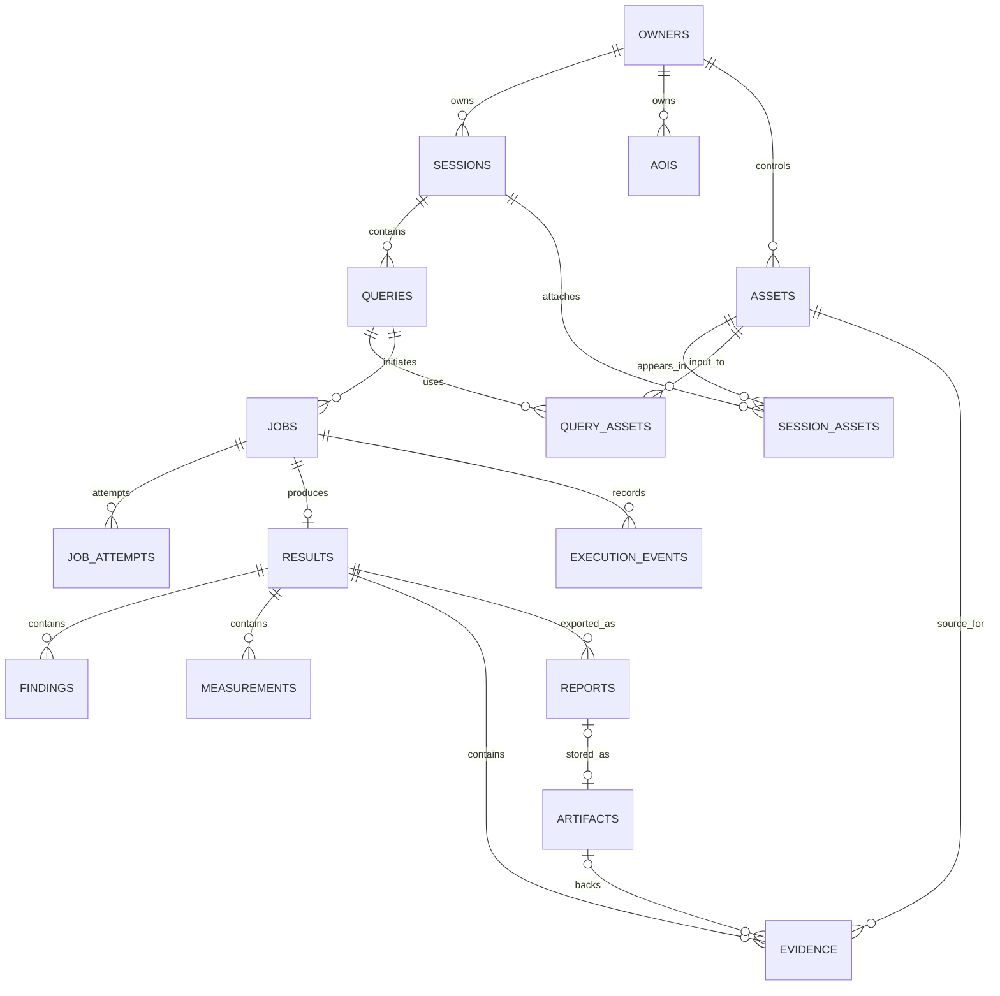

# Database foundation and logical design

## Status and persistence boundary

Phase 1 implements the PostgreSQL/PostGIS connection and migration foundation. Revision `20260907_0001` enables PostGIS; Task 6G revision `20260923_0002` adds `processing_jobs`, `processing_artifacts`, and `processing_job_events`. Task 10D revision `20260926_0003` adds only `geoagent_conversations` for bounded context; it is not the future full `sessions`/`queries` design. Phase 4 metadata/workspace and Phase 5 viewer state remain browser-local/stateless. The UI label `Saved in this browser` is not a database save, and all other domain tables and indexes below remain an **unimplemented logical design**.

The normal `db` service uses the `postgis/postgis:18-3.6` image line, binds only to `127.0.0.1`, and retains data in `satquery_postgres_data`. The `db-test` Compose profile is isolated on port `55432` by default, uses a database whose name ends in `_test`, and stores data in container tmpfs. The integration test rejects non-loopback URLs or database names without that suffix before applying migrations.

Application readiness performs bounded checks for PostgreSQL connectivity/server version, the `postgis` extension/version, and exact Alembic head. It returns unavailable for a connection failure, timeout, absent extension/table, or revision mismatch. It does not create or upgrade schema at application startup.

Docker was unavailable in the Phase 1 implementation environment, so the Compose boot, real migration, and successful readiness path remain **NOT RUN**, not inferred from unit fakes. See `docs/PHASE_1_REPORT.md`.

PostgreSQL/PostGIS stores structured ownership, metadata, geometry, lineage, job state, and result records. Large source rasters, uploads, masks, overlays, and reports live in private object storage. Database rows retain immutable storage keys, checksums, byte sizes, media types, lifecycle state, and provenance; signed URLs are never stored as canonical references.

## Entities

Phase 3 browser drafts use `satquery.aoi-draft.v1` in localStorage. They are not database rows, shared saved AOIs, or evidence of ownership. The roadmap's owned AOI gate remains pending: the `aois` table, migrations, authenticated API, and two-owner authorization tests are not implemented. The local one-ring Polygon subset does not change the target owned MultiPolygon schema below; conversion and broader support require explicit server validation.

| Entity | Purpose and principal fields |
|---|---|
| `owners` | Authorization boundary for a user or future tenant: `id`, external subject/tenant keys, status, timestamps. Exact identity model unresolved. |
| `sessions` | Owned workspace/history container: `id`, `owner_id`, name, state, created/updated/deleted timestamps. |
| `aois` | Owned validated AOI: `id`, `owner_id`, label, `geometry` (MultiPolygon, SRID 4326), bbox/area metadata with method, source, timestamps/version. |
| `assets` | Owned or permitted analytical asset reference: `id`, `owner_id`, source type/provider, provider asset ID, storage object ID, ingestion state, media type, checksum, byte size, acquisition interval, platform/sensor/product level, dimensions, resolution/units, CRS/geotransform/georeferencing status, footprint, nodata, band/polarization metadata, quality metadata with provenance, timestamps. |
| `session_assets` | Explicit many-to-many attachment of assets to sessions and display/analysis role. Ownership compatibility is enforced by service logic and constraints where feasible. |
| `queries` | Immutable user request: `id`, `owner_id`, `session_id`, question, normalized capability request/version, `aoi_id`, submitted timestamp, interpretation status. |
| `query_assets` | Query-to-asset links with semantic role (`primary`, `before`, `after`, `optical`, `sar`, etc.) and an input provenance snapshot/digest. |
| `jobs` | Asynchronous unit: `id`, `owner_id`, operation/capability version, state, idempotency key/request digest, priority policy, progress nullable, current attempt, queued/started/finished timestamps, cancellation fields, terminal error code/safe message, result ID. |
| `job_attempts` | Append-oriented attempt record: job ID, attempt number, worker/tool version, heartbeat, start/end, outcome, retry classification, sanitized error metadata. |
| `results` | Immutable structured result envelope: `id`, `owner_id`, `query_id`, `job_id`, schema version, support status, answer, warnings/limitations, execution summary, parameters/version reference, timestamps. |
| `findings` | Result-scoped supported statement with ordering, status, supporting evidence IDs, and machine-readable type. |
| `measurements` | Result/finding value or unavailable state, unit, method/version, denominator and exclusions, assumptions, precision, confidence reference, supporting asset IDs. Avoid false numeric defaults. |
| `evidence` | Result/finding evidence metadata: type, source asset ID, coordinate space, pixel geometry plus source dimensions/origin or PostGIS geographic geometry plus CRS, artifact ID, style/display hints that are not scientific facts. |
| `artifacts` | Private object metadata for input/derived/report objects: `id`, `owner_id`, storage provider/bucket/key, checksum, media type, byte size, purpose, source asset/result/job, lifecycle/expiry/deletion state, created timestamp. No signed URL. |
| `execution_events` | Append-only technical trace: `id`, job/attempt, sequence, event type/state, tool/version, safe parameter/input/output references, duration/error code, occurred time. Not chain-of-thought. |
| `reports` | Owned report request/version, source result, job, artifact, format, state, created/finished timestamps. |
| `catalog_searches` | Future owned search record: `id`, `owner_id`, provider adapter ID/version, normalized request schema version/digest, AOI reference or immutable validated geometry snapshot, UTC acquisition interval, provider-scoped collections, cloud-filter semantics, stable ordering, opaque-cursor state/expiry, status, attribution/warnings, error code, and timestamps. Task 4A creates no table; provider result caching/storage detail remains unresolved. |

Phase 5 tasks 5A and 5G create no table or migration. Version 1 viewer state is a closed browser-local draft bound to the Phase 4 AOI fingerprint, not an owned server resource. Tile-set IDs, URL templates, provider URLs, access expiry/status, credentials, raster bytes, and successful-render claims are excluded. Any future authenticated persistence requires an authorized owner/version/lifecycle model and migration; browser-local state is not database truth.

Provider catalogue items may initially remain normalized adapter responses tied to a search; if persisted, use a separate provider-asset table keyed by provider plus provider asset/version. Such a record must preserve normalized metadata, footprint/bbox, preview metadata without treating expiring URLs as canonical, licence/access state, metadata digest, source-record identity/version, adapter version, and field-level provenance. Do not overload `assets` until authorized pixels/access and provenance are established. Discovery alone creates neither an owned `asset` nor proof of analytical usability.

### Implemented Task 6G subset

Revision `20260923_0002` implements three tables only. `processing_jobs` stores an owner UUID and server-derived access scope, operation/version, idempotency/request/cache digests, closed request and safe source-version evidence JSON, lifecycle/timestamps/attempt, real stage units, safe terminal error, and completed quality/manifest JSON. `processing_artifacts` stores owner/job, private relative storage key, kind/media type, SHA-256, byte size, lifecycle, and creation time; it never stores provider URLs or client paths. `processing_job_events` stores append-only stage completion records with safe details.

Uniqueness on owner/operation/idempotency key enforces same-request replay and conflict behavior. Cache lookup is owner/access-scope constrained and requires a succeeded job, committed available artifact metadata, and present private files. Completion locks the running job and inserts all artifact rows plus success/report/manifest in one transaction after atomic file publication. Orphaned files after a database failure are unavailable because no successful authorized row references them. Identity integration remains unresolved, so protected routes fail closed unless a verified principal resolver is installed.

### Implemented Task 10D subset

Revision `20260926_0003` creates `geoagent_conversations` with composite primary key `(owner_id, access_scope, conversation_id)`, optimistic integer version, bounded validated JSON state and update timestamp. Protected reads/writes/deletes always include owner and scope. State holds the current AOI geometry, selected stable scene IDs and UTC dates, up to eight earlier optical candidates within the unchanged AOI, recent job/result references/status and the latest owner-authorized committed analysis reference. It excludes raw prompts, answer text, provider URLs, credentials and raster bytes. Replacing AOI/scenes invalidates dependent references; deleting the conversation removes context but does not delete/cancel separately owned jobs/artifacts. Exact retention/quotas/backups remain unresolved; this schema is not a production privacy-policy sign-off. Static migration head is verified; no live PostgreSQL migration was run in 10D.

## Relationships



All protected rows carry or can be unambiguously joined to `owner_id`; service authorization does not rely on a client-supplied owner. Foreign keys prevent orphaned job/result lineage. A database row-level-security layer is a future defense-in-depth decision, not assumed implemented.

## Spatial metadata and indexes

- AOIs use valid `MultiPolygon` geometry with SRID 4326. Asset footprints use valid `MultiPolygon` geometry with SRID 4326 only when source georeferencing supports them. Original CRS/WKT and transforms stay in asset metadata.
- Geographic API order is longitude/latitude. Pixel evidence is not stored as misleading SRID 4326 geometry; use an explicit pixel geometry representation plus source asset/dimensions/origin.
- Use GiST indexes on `aois.geometry` and `assets.footprint`; test actual intersection/containment query plans. Add B-tree indexes for owner plus creation time/ID, provider plus provider asset ID/version, acquisition time, session/query/job foreign keys, job state/queue ordering, and artifact lifecycle.
- Uniqueness candidates include `(provider, provider_asset_id, provider_version)` where stable, `(owner_id, operation, idempotency_key)` with request digest semantics, `(job_id, attempt_number)`, and `(job_id, sequence)` for events. Final constraints follow actual concurrency design.
- Raster pixel arrays do not belong in ordinary relational rows. PostGIS Raster is not selected; use it only after a workload-specific decision.

## Provenance and immutability

An asset records source/provider, provider identifier/version, acquisition metadata source, checksum when bytes are obtained, ingestion/tool version, and storage identity. Query inputs use immutable asset IDs plus a provenance snapshot/digest. Results, findings, measurements, and evidence are immutable after publication; corrections create a new result/schema version with lineage rather than rewriting scientific history.

Measurements retain method/version, units, denominators, excluded-pixel policy, assumptions, and source assets. Execution events retain only an auditable tool summary and safe references, never hidden model reasoning or secrets.

## Retention, deletion, and ownership

- Exact retention periods, quotas, legal holds, and sharing rules are unresolved product/security decisions.
- Deleting a session does not silently destroy immutable analyses if retention requires them; the UI/API must communicate the effect before deletion.
- Deleting an uploaded asset is rejected or staged while active jobs depend on it. Historical results retain provenance metadata even if bytes later expire, subject to privacy/legal policy.
- Owner deletion triggers a documented, auditable cascade/tombstone workflow across rows and private objects. Object deletion is asynchronous and retried; status prevents an object pending deletion from receiving new signed URLs.
- Provider/shared source data is dereferenced rather than physically deleted when SatQuery does not own the source. Derived/user-uploaded objects follow their lifecycle policy.
- Backups and replicas inherit retention and deletion requirements; restore procedures must not revive deleted access indiscriminately.

## Migration strategy

Alembic is the selected migration tool. `backend/alembic.ini` and `backend/alembic/env.py` load the same validated root configuration as the application and use a `NullPool` migration connection. The online runner uses `SelectorEventLoop` on Windows for Psycopg async compatibility and applies the configured database connect timeout. Revision `20260907_0001` runs `CREATE EXTENSION IF NOT EXISTS postgis`; downgrade intentionally leaves PostGIS installed because an extension can be shared. Revision `20260923_0002` creates the narrow Task 6G preparation subset above; head `20260926_0003` adds the narrow Task 10D conversation table. Production mutation never relies on ORM auto-create.

Local development applies the current head explicitly:

```powershell
Set-Location backend
..\.venv\Scripts\python.exe -m alembic upgrade head
```

The isolated verification command starts only `db-test`, upgrades from empty, checks PostGIS and the expected revision through application code, inspects `alembic current`/`heads`, and removes only the test container:

```powershell
.\scripts\verify-database.ps1
```

Future migrations remain deterministic and reviewed for locks, data/backfill cost, rollback/forward-fix, and supported upgrade paths. Production deployment must run migrations as a separate gate with suitable backup/recovery controls.
