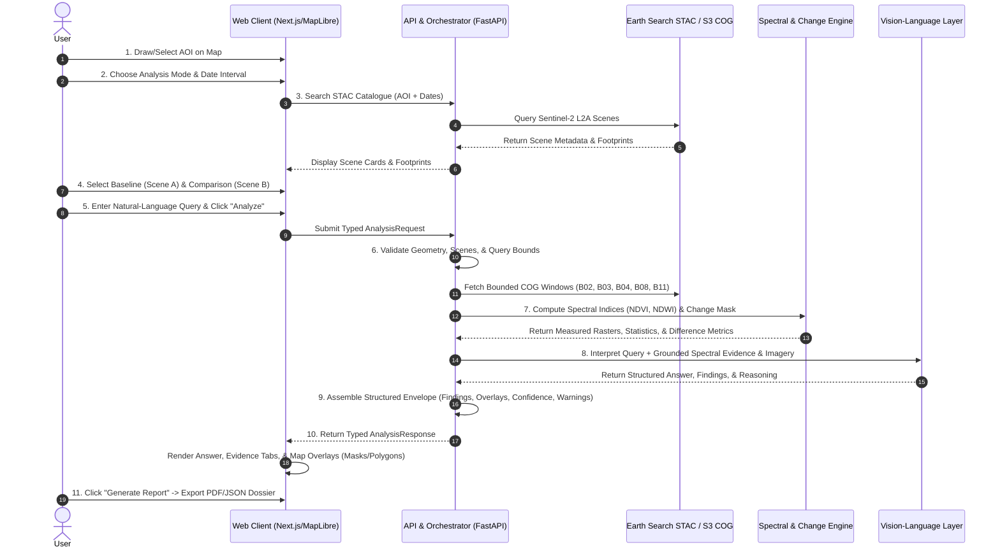

# Product Requirements Document (PRD)

## 1. Product Vision

**SatQuery AI** is an interactive, evidence-grounded Vision-Language Assistant designed for multimodal remote-sensing Earth Observation (EO) analysis through natural language text queries. 

SatQuery AI bridges the gap between raw satellite imagery repositories and actionable geospatial intelligence. It empowers analysts, planners, environmental monitors, and decision-makers to select an Area of Interest (AOI), discover real Sentinel-2 satellite imagery, perform before/after comparisons, ask natural-language questions, and receive trustworthy answers backed by measured spectral/spatial evidence, grounded map overlays, calibrated confidence scores, and auditable analysis reports.

---

## 2. Problem Statement

Remote sensing workflows currently suffer from major friction points:
1. **Tool Fragmentation:** Users must juggle disparate tools for catalogue search (STAC/Copernicus), GIS visualization (QGIS/ArcGIS), raster computing (Python/GDAL/Rasterio), and narrative report authoring.
2. **Hallucination & Fabrication Risks:** Standard multimodal Large Language Models (LLMs) hallucinate geospatial facts, invent non-existent geographical coordinates, and fabricate statistical trends when fed ungrounded imagery.
3. **Lack of Verifiable Spatial Evidence:** Non-specialists cannot verify whether an AI assertion (e.g., *"15% vegetation loss observed"*) stems from real spectral measurement (such as NDVI differencing) or language model approximation.
4. **Complex Preprocessing Overhead:** Fetching multi-gigabyte satellite scenes just to inspect a small AOI wastes bandwidth and computing time.

---

## 3. Target Users & Personas

* **Geospatial Analysts & Remote Sensing Researchers:** Need precise spectral indices (NDVI, NDWI, NDBI), exact UTC timestamp provenance, sensor metadata, and verifiable spatial difference masks.
* **Urban Planners & Environmental Monitors:** Need rapid assessment of land cover changes, water body fluctuations, deforestation, and construction activity over specific administrative or natural boundaries.
* **Disaster Response & Relief Coordinators:** Need immediate before/after event change analysis (floods, landslides, wildfire burn scars) with visual map grounding and high-reliability confidence disclosures.
* **Hackathon / SIH Evaluators & Stakeholders:** Need an intuitive, responsive, end-to-end vertical slice demonstrating real-time natural language query interpretation grounded in actual Sentinel-2 satellite data with zero mock fallbacks.

---

## 4. Primary Use Cases

1. **Single-Scene Visual & Spectral Inspection:** Draw an AOI over a region, discover current Sentinel-2 imagery, and ask questions such as *"What is the vegetation and water distribution in this zone?"*
2. **Two-Date Temporal Change Detection:** Select two distinct acquisition dates (e.g., pre-monsoon vs. post-monsoon or pre-flood vs. post-flood) and ask *"What changed between these two dates?"*
3. **Targeted Environmental Querying:** Ask domain-specific questions such as *"Identify water bodies and calculate the water surface area in square kilometers."*
4. **Auditable Intelligence Dossier Generation:** Export a formal, timestamped analysis report containing input imagery provenance, question, answer, method disclosures, spectral evidence, confidence scores, and map visuals.

---

## 5. Core SIH Demo Workflow

The Smart India Hackathon (SIH) end-to-end vertical slice follows a continuous 11-step interactive journey:

---

## 6. Functional Requirements

| Requirement ID | Feature Area | Description & Acceptance Intent |
|---|---|---|
| **PRD-AOI-001** | **AOI System** | The user can draw rectangular or polygonal AOIs on the interactive map, enter coordinate bounds, or import GeoJSON. The system calculates geodesic area ($\text{km}^2$), checks self-intersections, and retains browser drafts. |
| **PRD-DSC-001** | **Imagery Discovery** | The system queries real Element 84 Earth Search STAC API for Sentinel-2 L2A imagery within the AOI and date range. Discovered scenes display acquisition time, cloud percentage, platform ID, and map footprints. |
| **PRD-CMP-001** | **Two-Date Selection** | The user can assign distinct scenes to Scene A (earlier) and Scene B (later). The interface validates temporal ordering and spatial overlap before enabling change analysis. |
| **PRD-QRY-001** | **Natural Language Input** | The user can input natural language questions or select domain presets (vegetation, water, urban change) bound to the selected scene(s) and AOI. |
| **PRD-ENG-001** | **Spectral Analysis** | The backend computes real spectral indices from raw bands (NDVI for vegetation using Red/NIR, NDWI for water using Green/NIR) over the bounded AOI without downloading full-scene files. |
| **PRD-CHG-001** | **Change Detection** | For two-scene workflows, the backend computes pixel-level difference masks ($\Delta\text{NDVI}$, $\Delta\text{NDWI}$), classifies significant positive/negative shifts, and calculates surface area changes in $\text{km}^2$ and percentage. |
| **PRD-VLM-001** | **Grounded AI Interpretation** | A Vision-Language AI model synthesizes the visual imagery and calculated spectral metrics to directly answer the user's question. The model is constrained to verified evidence and prohibited from inventing numbers or coordinates. |
| **PRD-EVD-001** | **Grounded Overlays & Evidence** | Analysis responses provide vector (GeoJSON Polygon/MultiPolygon) or raster overlay layers (NDVI colormaps, change masks) displayed directly on the MapLibre canvas with toggleable opacity. |
| **PRD-CNF-001** | **Confidence & Warnings** | Every analysis provides a calibrated confidence score on a $0.0 - 1.0$ scale with factor breakdown (data quality, cloud cover, sensor resolution, model certainty) and standardized machine-readable warning codes. |
| **PRD-RPT-001** | **Report Export** | The user can download a structured analysis report (PDF or formatted JSON) containing the query, AOI metadata, imagery provenance, spectral measurements, grounded findings, visual evidence, and limitations. |

---

## 7. Non-Functional Requirements

* **PRD-NFR-ACC-001 (Scientific Accuracy & Traceability):** Every quantitative assertion must identify its source imagery, band formulas, spatial units ($\text{km}^2$), and assumptions. Language models cannot act as the primary measurement instrument.
* **PRD-NFR-PERF-001 (Responsiveness):** STAC catalogue search must return in $< 2.0\text{s}$. Spectral processing and AI analysis for standard AOIs ($< 100\text{ km}^2$) must complete in $< 15.0\text{s}$.
* **PRD-NFR-SEC-001 (Security & Credential Safety):** Zero client-side exposure of backend API keys or cloud credentials. All external provider requests are authenticated and mediated server-side.
* **PRD-NFR-REL-001 (Resilience & Graceful Degradation):** If a provider tile or VLM API encounters transient timeouts, the system returns structured, user-actionable error envelopes rather than blank screens or crashed processes.
* **PRD-NFR-GEO-001 (Coordinate Precision):** All spatial data adheres strictly to WGS 84 (EPSG:4326) with GeoJSON `[longitude, latitude]` coordinate order per RFC 7946.

---

## 8. MVP Acceptance Criteria (SIH Vertical Slice)

1. **Interactive AOI:** Able to draw an AOI over any global region (e.g., Bengaluru, New Delhi, Sundarbans) and receive instant geodesic area feedback.
2. **Live Imagery Search:** STAC discovery returns real Sentinel-2 L2A scenes with exact UTC dates, thumbnails, and interactive map footprints.
3. **True COG Tile Display:** High-resolution RGB raster tiles load smoothly on the MapLibre canvas via the server tile proxy.
4. **Before/After Selection:** Comparison mode supports selecting two valid dates and renders Swipe/Split visual views.
5. **Grounded Question & Analysis:** Clicking "Analyze" on a query (e.g., *"Assess vegetation change and water presence"*) returns structured findings, calculated metrics ($\Delta\text{NDVI}$, water $\text{km}^2$), and a concise narrative answer.
6. **Map Overlay Rendering:** The resulting spectral/change detection mask renders as an interactive layer on top of the satellite map.
7. **Transparent Confidence & Limitations:** Displays overall confidence score (e.g., `0.87 / 1.00`), factor breakdown, and cloud/resolution caveats.
8. **Report Generation:** User can click "Download Report" and receive a complete, styled analysis dossier.

---

## 9. Out-of-Scope for SIH MVP

* Multi-tenant user billing and subscription tiers.
* Cadastral surveying / sub-meter drone photogrammetry.
* Raw SAR interferometric phase unwrapping (complex InSAR pipelines).
* Autonomous drone tasking or satellite constellation commanding.
* Global batch offline re-indexing of historical Petabyte archives.

---

## 10. Success Metrics

* **End-to-End Task Completion:** $100\%$ successful execution of the 11-step demo workflow during live presentation.
* **Zero Fabrication Rate:** $0$ ungrounded coordinates or invented statistical metrics in generated analysis responses.
* **Latency Benchmark:** End-to-end query submission to grounded map result in under $15\text{ seconds}$.
* **Verification Pass Rate:** $100\%$ pass on automated backend/frontend test suites, strict typechecking, and linting.
